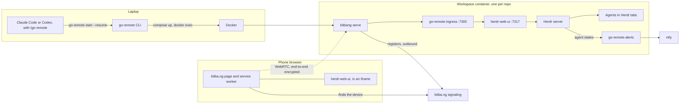
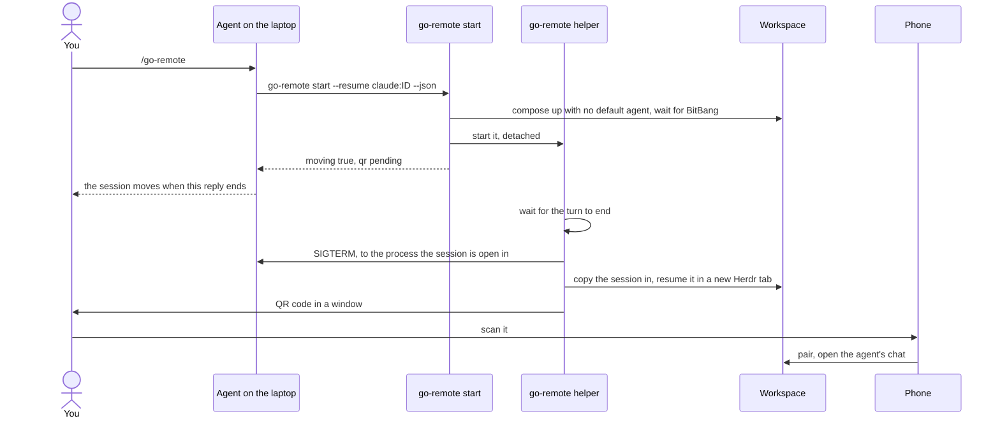

# Architecture

How go-remote works: what runs where, how a phone reaches an agent, and why the pieces are shaped the way they are. For
how to change it, see [AGENTS.md](AGENTS.md); for how to use it, see [README.md](README.md).

## Overview



There are three parts:

- **The image and its compose service.** `Dockerfile` builds a Debian image with the pinned agent CLIs, BitBang, Herdr,
  herdr-web-ui and Bun. `docker-compose.yml` runs it as one hardened `workspace` service, and every repo gets its own
  compose project. `docker/entrypoint.bash` starts everything inside.
- **The host CLI.** `go-remote` (`cli/`) starts and finds workspaces, signs agents in, moves agent sessions between the
  laptop and a workspace, and shows the QR code. The make targets are thin wrappers around it.
- **The skill.** `/go-remote` (`skills/go-remote/SKILL.md`) tells an agent how to move its own session: find its session
  ID, run `go-remote start --resume`, and end its turn.

Nothing in the container listens on anything but loopback, and no port is published. `bitbang serve` registers with the
signaling server over an outbound connection. A phone that opens the URL finds the device through that server, then
talks to the listener over WebRTC, directly or through a TURN relay. The signaling server and the relay see only
encrypted traffic.

## The two modes

`GR_UI` picks what the listener serves. `build_listener_args()` in `docker/entrypoint.bash` assembles its command line.

| Mode            | Listener                                                                  | What the phone gets                                                       |
| --------------- | ------------------------------------------------------------------------- | ------------------------------------------------------------------------- |
| `web` (default) | `bitbang serve -proxy-client-ip ... proxy 127.0.0.1:7300`                 | herdr-web-ui through the ingress: a chat view per agent, terminals, files |
| `shell`         | `bitbang serve -disable-shell-mirror -shell-max-sessions N ... shell ...` | BitBang's own terminal on one shared tmux session (`go-remote-session`)   |

Both add `-pin` when `BITBANG_PIN` is set, and `-ice-servers` when `config/ice-servers.json` exists. In the web mode,
the chain is:

```text
bitbang serve (proxy)  ->  go-remote-ingress 127.0.0.1:7300  ->  herdr-web-ui 127.0.0.1:7317  ->  Herdr server socket
```

The shell mode starts none of the web mode's services, and the smoke test checks that neither Herdr nor herdr-web-ui
runs.

## Why the ingress exists

BitBang does not behave like an ordinary reverse proxy, and herdr-web-ui expects one. The phone loads the bitba.ng page,
which shows the device's page in a same-origin iframe. BitBang's service worker carries that iframe's requests over
WebRTC to `bitbang serve`, which proxies them to the ingress. `go-remote-ingress` (`ingress/server.ts`, with the rules
in `ingress/rewrite.ts`) and the script it adds to every page (`ingress/compat.js`) bridge the two. Each fix answers a
specific limit, and most would go away with a change upstream.

- **`Host`.** BitBang sets `Host` to its proxy target, so the ingress restores it from `X-Forwarded-Host`
  (`upstreamRequestHeaders()`). It could go if herdr-web-ui honoured `X-Forwarded-Host` from a trusted proxy.
- **Proxy evidence.** herdr-web-ui treats a request with no sign of a proxy as coming from this machine. BitBang sends
  `X-Forwarded-Proto`, and the ingress adds it if it is ever missing, so a phone is never mistaken for the laptop. This
  is a guard, and stays.
- **Tailscale headers.** herdr-web-ui trusts `tailscale-*` identity headers, which only `tailscale serve` should state,
  and any phone could send them. The ingress drops them all. This is a trust boundary, and stays.
- **The frame and the inline script.** herdr-web-ui sends `frame-ancestors 'none'` and `script-src 'self'`, while
  BitBang frames the page and its service worker prepends an inline bootstrap script. The ingress moves the app's policy
  into a meta tag placed after BitBang's scripts, keeps only `frame-ancestors 'self'` as a header, and drops
  `X-Frame-Options` (`rewriteHtml()`, `downstreamResponseHeaders()`). It needs both ends to change before it can go:
  BitBang loading its bootstrap as an external same-origin script, and herdr-web-ui letting a same-origin page frame it.
  Either change alone still leaves the phone with a blank frame.
- **The query string.** BitBang's request shim drops the query when it strips its `/__device__/<session>` prefix, which
  would lose the pairing code and the pane. `compat.js` puts the query back from the frame's navigation entry. It could
  go if BitBang kept the query.
- **`Origin`.** BitBang's proxy does not forward `Origin`, which herdr-web-ui's check against cross-site writes wants.
  `compat.js` adds `x-herdr-machine` to the app's own same-origin requests, which another site cannot do. It could go if
  BitBang forwarded `Origin`.
- **Service workers and push.** BitBang's service worker controls the frame, so the app's own would collide with it.
  `compat.js` makes registration fail and removes `PushManager`, and `ingress/alerts.ts` sends alerts through ntfy
  instead.
- **iOS zoom.** iOS zooms into a focused field whose text is under 16px, and only the parent page could stop it.
  `compat.js` sets a 16px minimum for fields on touch screens. It could go if BitBang's page set a viewport that
  prevents the zoom.
- **The About page.** herdr-web-ui's updater controls and telemetry do not apply in go-remote's hardened image.
  `compat.js` presents matching cards for go-remote, herdr web ui, herdr and BitBang, reads the visible upstream version
  labels, and hides the React-owned source sections rather than rewriting them.
- **The tab title.** BitBang copies the frame's title to the tab once, when the frame loads. `compat.js` renames the
  app's "herdr web ui" title, and the titles it sets later, to Go Remote.

Some rules hold whatever the fixes:

- Only the app's own pages are rewritten: successful HTML responses outside `/api/` (`shouldRewrite()`).
- A page whose policy has `sandbox` is never rewritten. herdr-web-ui sends it for files from the repo, and moving that
  policy to a meta tag would drop the sandbox (`canMoveToMeta()`). Such previews stay unframeable inside BitBang.
- Request URLs are never logged, because a scanned link carries the pairing code in its query.
- WebSockets are bridged with the upstream socket opened first, so a refusal answers the handshake with an error rather
  than a socket that closes at once. Anything the upstream sends, or a close, before Bun opens the browser's socket is
  held and replayed in order (`relayUpstream()`). Idle timeouts are off, because the app holds event streams open.

The ingress depends on herdr-web-ui details that are not a documented contract: the `x-herdr-machine` header and the
page's markup. herdr-web-ui is pinned to a commit, and `make e2e` catches a release that breaks the ingress.

## The container's lifecycle

`docker/entrypoint.bash` runs as the `agent` user, under `init`. In order, `main()`:

1. Creates `/tmp/go-remote` and `/tmp/bitbang` (mode 700) on the tmpfs, and sets the health file to `starting`.
2. `check_workspace`: refuses to start unless something is mounted at `GR_REPO`, the repo's absolute host path.
   `/workspace` links to it.
3. `configure_git`, under a lock in the home volume: marks the repo safe, rewrites GitHub SSH remotes to HTTPS (the
   container has no SSH keys), excludes `/.herdr-web-ui/` and `/.go-remote/` in `.git/info/exclude`, and lets `gh`
   supply the credentials when `GH_TOKEN` is set.
4. In the web mode:
   - `start_herdr` installs Herdr's integrations for Claude Code, Codex and Cursor, which report session IDs, and
     answers the agents' first-run questions (`go-remote-agent prepare`). It then starts the Herdr server and gives the
     repo a workspace whose first tab is Repo Shell.
   - `start_default_agent` runs `go-remote-agent watch`, which starts the default agent (`GR_DEFAULT_AGENT`) in its own
     tab as soon as one is signed in.
   - `start_web_ui` starts herdr-web-ui from source, with a random access token kept in the tmpfs and auto-update and
     telemetry off, then the ingress in front of it.
   - `start_alerts` starts `go-remote-alerts` when `GR_NTFY_TOPIC` is set.
5. `start_listener` runs `bitbang serve` with `HOME` on the tmpfs, waits up to 60 seconds for it to register, and
   records its URL in `/tmp/bitbang/url`. If it never registers, the container exits.
6. `supervise_listener`, the watchdog: every `GR_WATCHDOG_INTERVAL` seconds (300 by default), it connects to its own URL
   with `bitbang connect`, and in the web mode also checks that the app answers through the ingress. After two failures
   in a row it marks the health `stale` and restarts the listener, with the same identity, so the URL keeps working. A
   listener that exits is restarted three seconds later.

Each service runs under `keep_running`, which restarts it when it exits and prefixes its output with its name in the
container log. The health file (`/tmp/bitbang/health`) feeds both compose's healthcheck and the CLI's
`waitForListener()`, which returns the URL once the health is `ok`.

The listener's identity lives on the tmpfs, so the URL lasts exactly as long as the container. That is why compose sets
`restart: "no"`: a restarted container would start with a fresh tmpfs and a URL nobody has seen, while the old link
stopped working. The container stays down instead, and `go-remote start` brings up a new one.

## Workspaces

- **One compose project per repo,** named `go-remote-<directory name>`. The name is computed by `go_remote_project` in
  `Common.make` and by `projectName()` in `cli/src/workspace.ts`, the same way. `bringUp()` in
  `cli/src/commands/start.ts` refuses to reuse a project that already serves a different repo with the same directory
  name.
- **Labels** let go-remote find workspaces without any state on the host: `go-remote.repo` holds the mounted path, and
  `go-remote.env-file` the env file the container was given, so `go-remote login` restarts only the workspaces its token
  is for.
- **One env file** per workspace, `.env` or the one `GR_ENV_FILE` names. Compose gives it to the container as its
  `env_file`, and `compose()` in `cli/src/workspace.ts` also passes it as `--env-file`, so compose's own `${GR_*}`
  settings, such as the mode and the home volume, come from the same file. That is how the e2e test's throwaway file
  keeps it off the checkout's `.env`.
- **The home volume** (`go-remote-home`) is shared by every workspace. It holds sign-ins, shell history, git config,
  agent sessions, and herdr-web-ui's pairings, which are kept per Herdr session. It is external, so
  `docker compose down -v` leaves it alone; `ensureHomeVolume()` creates it, and `make clean-home` deletes it.
- **One Herdr session per workspace.** `HERDR_SESSION` is the compose project name, so workspaces that share the volume
  never share a Herdr server. `fresh_session()` gives a new container a new session, with the last one's tabs gone,
  while a restarted container keeps its own; the container ID tells the two apart.
- **The repo is mounted at its host path,** not at `/workspace`. Claude Code keys a session's folder on the directory it
  ran in, and Codex records that directory in the rollout, so a transcript copied from the laptop resumes unchanged. The
  cost is that a repo path must not collide with the container's own (`RESERVED_PATHS`), and `resolveRepo()` refuses
  `/`, the home directory and git worktrees.
- **The Mac stays awake** while a workspace runs: `keepAwake()` in `cli/src/host.ts` runs
  `caffeinate -i -s docker wait <container>`, which ends when the container stops.

## The host CLI

`cli/src/main.ts` parses the command line and dispatches to `cli/src/commands/`. Bun compiles the CLI into one
executable per platform, with `package.json`'s version and the skill's text built in.

| Module                   | Role                                                                                                 |
| ------------------------ | ---------------------------------------------------------------------------------------------------- |
| `commands/start.ts`      | `start`: brings a workspace up, optionally hands it a session or starts an agent, and shows the link |
| `commands/workspaces.ts` | `qr`, `ls`, `attach`, `logs` and `stop`, for workspaces that already exist                           |
| `commands/login.ts`      | `login`: Claude Code's token on the laptop, or a sign-in inside a running container                  |
| `commands/sessions.ts`   | `sessions` lists the laptop's sessions for a repo; `pull` brings the container's back                |
| `commands/doctor.ts`     | `doctor`: Docker, the image, `.env`, and the agent CLIs' versions against the image's pins           |
| `commands/skill.ts`      | `install-skill`: from skills.sh when it is published there, else the copy built into the CLI         |
| `workspace.ts`           | Compose projects, labels, the home volume, `docker exec`, and waiting for the listener               |
| `sessions.ts`            | Finding Claude Code and Codex sessions on either side, and writing pulled ones back with a backup    |
| `handoff.ts`             | The container side: copying sessions in, starting agents in Herdr tabs, finding what to pull         |
| `move.ts`                | The background helper that finishes a move once the agent's turn ends                                |
| `link.ts`, `present.ts`  | The phone's link, and showing it only to the person at the laptop                                    |
| `setup-token.ts`         | Running `claude setup-token` on a pseudo-terminal and reading the token without ever showing it      |
| `config.ts`, `env.ts`    | Finding the checkout, and creating and checking its `.env`                                           |
| `versions.ts`, `host.ts` | The agent CLIs' version pins; the QR window and keeping the Mac awake                                |

What it keeps on the host:

| Path                                                   | What it is                                                                       |
| ------------------------------------------------------ | -------------------------------------------------------------------------------- |
| `~/.config/go-remote/config.json`                      | The checkout to use, written by `go-remote setup`, which `make install-cli` runs |
| `~/.local/state/go-remote/`                            | Each move's lock and log; the logs hold no links                                 |
| `.env` in the checkout, or `GR_ENV_FILE`               | Keys and settings, mode 600                                                      |
| `~/.local/bin/go-remote` and `gr` (or `BIN_DIR`)       | The installed CLI, and the short name linked to it                               |
| `~/.agents/skills/go-remote`, `~/.claude/skills/` link | The skill, for Codex and Cursor, and for Claude Code                             |

The CLI finds its checkout in this order: `--root`, `GR_ROOT`, `config.json`, then the checkout a `dist/` binary sits in
(`resolveRoot()`).

## Moving a session



The agent that runs `/go-remote` is still in the turn that ran it, so `go-remote start` cannot move the session right
away. Instead:

1. `sessionToHand()` checks that the session ran inside the repo, and sees it is mid-turn (`inTurn()`), so this is a
   move. It refuses if a move of the same session is already waiting, or if no agent process runs above it
   (`callingAgent()`): a move started from another terminal would have nothing to end, and leave two writers. It also
   refuses when the agent above it says it is running a different session (`otherSession()`, from
   `CLAUDE_CODE_SESSION_ID` or `CODEX_THREAD_ID`), because ending that agent would close the wrong conversation.
2. `start` brings the workspace up with `GR_DEFAULT_AGENT=none`, waits for the listener, and checks the agent can work
   in the container. If it cannot, the session stays on the laptop. It also checks the container's copy of the session
   (`checkCopyIn()`, below).
3. `spawnMove()` starts the helper (`go-remote __move`) in its own session, so the agent's tool cannot take it down, and
   returns `"moving": true`. The agent tells you, and ends its turn.
4. `finishMove()`, in the helper, waits until the transcript has been still for 1.5 seconds and either shows the turn
   ended (`turnEnded()`) or the agent has gone, for up to ten minutes. It checks the container's copy again, then ends
   the laptop's copy with `SIGTERM`, but only if that process's command line is unchanged, so the session never has two
   writers.
5. It copies the session in (`copyIn()`, through `docker exec` as the agent user, so the files are not owned by root),
   resumes it in a new Herdr tab (`startAgent()`; a fresh agent also gets `--model` from the brief's `Model:` line or
   `GR_MODEL`), gives it the brief if there is one, and opens the QR code in a window. A line on the terminal the agent
   ran in says what happened, once the agent has left it.

Copying in never loses work in the container. Transcripts only grow, so `checkCopyIn()` compares each file's size and
SHA-256 with the laptop's: a container copy that is a prefix of the laptop's is older and is replaced, and an identical
one is left alone. A copy that is longer or different holds turns from the phone, so the move is refused until
`go-remote pull` brings them back. So is a session still open in any running workspace, since they share the home
volume.

From a terminal, `go-remote start --resume` moves a session you have already quit; it asks first if the transcript
changed in the last minute. `--fork` continues a copy instead. `go-remote pull` brings sessions back: it refuses while
one is still open in any running workspace (`openAnywhere()`, the same check a move makes), copies only that repo's
session files, and keeps a `.bak` of any laptop copy it replaces. It is the same comparison in reverse (`pullState()`):
a container copy that is a prefix of the laptop's means the session went on here since, so the laptop's is kept. Nor
does it replace a session an agent on the laptop has open (`openHere()`): one whose command line names the session, as
the resume command `pull` prints does, or the one running go-remote. Cursor sessions cannot move yet: `SessionAgentKind`
leaves Cursor out until go-remote can read its transcripts.

## The link and pairing

A BitBang URL is `https://bitba.ng/<id>#<code>`. Everything after the first `/` in the fragment is the address BitBang
opens inside the container, and a fragment never reaches the signaling server. `deviceLink()` in `cli/src/link.ts` puts
herdr-web-ui's one-time pairing code, the pane and the view there, so one scan connects, pairs and opens the right chat.
Unless `GR_RELAY=auto`, `forceRelay()` adds BitBang's `relay` flag after the code, so the browser connects through the
TURN relay at once instead of first trying a direct path, which from a phone to Docker Desktop costs seconds and leaves
a much slower connection.

- The pairing code comes from `go-remote-pair` (`docker/pair.bash`), which asks herdr-web-ui inside the container,
  because only the container holds the app's access token. A code is six digits, lasts ten minutes, and admits one
  device. Paired devices stay paired, per repo, in the home volume.
- `showLink()` in `cli/src/present.ts` prints the QR code only on an interactive terminal. Otherwise, when an agent ran
  the command or its output goes to a pipe, the link never reaches stdout or stderr, and the QR code opens as an image
  in a private temporary directory that is deleted ten minutes later.
- `redact()` takes BitBang URLs and connection IDs out of anything that may reach a log or an agent, such as
  `go-remote logs`.

## Sign-in and secrets

- **Claude Code** signs in once, on the laptop: `go-remote login` runs `claude setup-token` on a pseudo-terminal, passes
  its screen through until the token is about to appear, and reads the token from a terminal emulator fed the same
  output (`cli/src/setup-token.ts`). The token goes into `.env` as `CLAUDE_CODE_OAUTH_TOKEN`, and every workspace gets
  it when it next starts.
- **Codex and Cursor** sign in inside a running container (`go-remote-agent login`), and the home volume keeps the
  sign-in for every workspace. Cursor can use `CURSOR_API_KEY` from `.env` instead.
- **Secrets reach the container only through compose's `env_file`.** Compose never interpolates them, so a key exported
  in the host shell cannot override `.env` or leak into a container that can be reached remotely.
- **The default agent** is started by `go-remote-agent watch` once one is signed in: with `GR_DEFAULT_AGENT=auto`, the
  first of Claude Code, Codex and Cursor. An agent that opened at its sign-in screen is restarted in its tab after a
  sign-in elsewhere, so a sign-in never needs a container restart.

## Alerts

`go-remote-alerts` (`ingress/alerts.ts`) watches Herdr for an agent that needs you or has finished its turn, and posts
to ntfy, so the phone hears about it with the BitBang tab closed. herdr-web-ui's own Web Push cannot work inside
BitBang's frame. An alert names the agent and the repo, never transcript text, because the ntfy server may be a public
one. The topic is the secret, so it is never logged. Tapping an alert cannot open the session, because the BitBang URL
is a credential and must not travel through ntfy. A request to Herdr or to ntfy gives up after ten seconds, so a server
that stalls delays the next poll rather than silencing every later alert.

## Security model

The README's [security model](README.md#security-model) lists the controls and their limits. The trust boundaries behind
them:

- **The container against the host.** The repo, the home volume, and the checkout's `config/` (read-only, for TURN
  settings) are the only mounts. The root filesystem is read-only, every capability is dropped, the user is not root,
  and there is no Docker socket. The network is open: the container can reach whatever the host can.
- **BitBang's servers.** The signaling server sees the listener register and phones look it up, but sessions are
  end-to-end encrypted and it cannot read or join them. The fragment, which holds the connection code and the pairing
  code, never reaches it. A TURN relay forwards only encrypted packets.
- **Who gets in.** In the web mode, the URL alone reaches only the pairing screen, and the pairing code admits one
  device. In the shell mode, the URL is a shell, so `BITBANG_PIN` adds a second factor for both modes.
- **Agents.** The link never passes through an agent's context, the logs hold no links, and a moved session's transcript
  travels with it into the home volume.

## Version pinning

Every component in the image is pinned in the `Dockerfile`, and each pin is checked in its own way:

| Component          | Pinned by                                   | Checked against                                 |
| ------------------ | ------------------------------------------- | ----------------------------------------------- |
| BitBang            | `BITBANG_VERSION`                           | The release's `checksums.txt`                   |
| Herdr              | `HERDR_VERSION`                             | A SHA-256 per architecture, in the `Dockerfile` |
| Cursor Agent CLI   | `CURSOR_AGENT_VERSION`                      | A SHA-256 per architecture, in the `Dockerfile` |
| herdr-web-ui       | `HERDR_WEB_UI_VERSION`, a tag               | `HERDR_WEB_UI_COMMIT`, and its frozen lockfile  |
| Claude Code, Codex | `CLAUDE_CODE_VERSION`, `CODEX_VERSION`      | npm, by exact version                           |
| Bun, uv            | The tags of the images they are copied from | Nothing beyond the tag                          |

The image records every version but uv's as a `go-remote.version.*` label, and the smoke test checks that what is
installed matches them. Nothing updates itself: Claude Code has `DISABLE_AUTOUPDATER`, Herdr's version checks are off in
`docker/herdr.toml`, herdr-web-ui runs from source with `HERDR_WEB_AUTO_UPDATE=0`, and Cursor starts with
`--disable-auto-update`.

Transcript formats are internal to each agent, so the CLI compares the laptop's agent version with the image's
(`PIN_LABELS` and `skewWarning()` in `cli/src/versions.ts`) when a session moves, and `go-remote doctor` shows both.

## Tests

| Layer      | Where                                    | Run with                | What it proves                                                                                        |
| ---------- | ---------------------------------------- | ----------------------- | ----------------------------------------------------------------------------------------------------- |
| Unit       | `cli/src/*.test.ts`, `ingress/*.test.ts` | `make unit`, `bun test` | The CLI's logic, and the ingress against a stand-in herdr-web-ui                                      |
| Smoke      | `scripts/smoke-test.bash`                | `make test`             | A throwaway container in both modes: hardening, toolchain and pins, git, both UIs, BitBang end to end |
| End to end | `scripts/e2e.bash`, `e2e/phone.mjs`      | `make e2e`              | A phone (Chromium, as a Pixel 7) through a real BitBang URL: pairing, terminal, chat, a session move  |

The end-to-end test answers Claude Code with a stand-in Anthropic API (`e2e/mock-anthropic.ts`) inside the container, so
it needs no real sign-in. Neither the smoke nor the end-to-end test reads `.env`, and neither prints a URL or a pairing
code.
